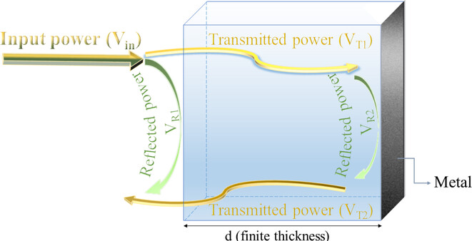
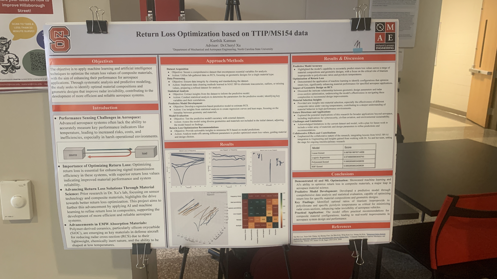
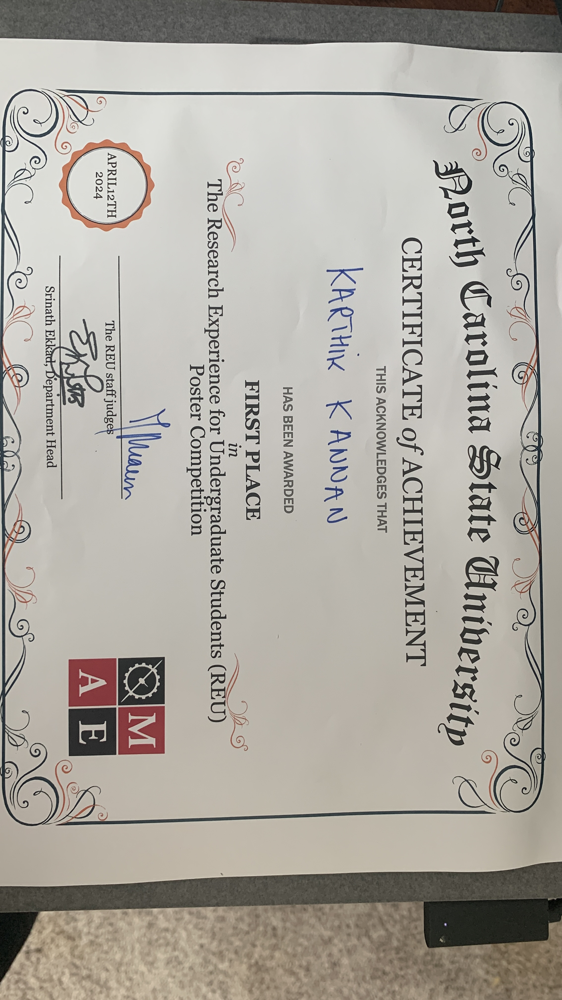
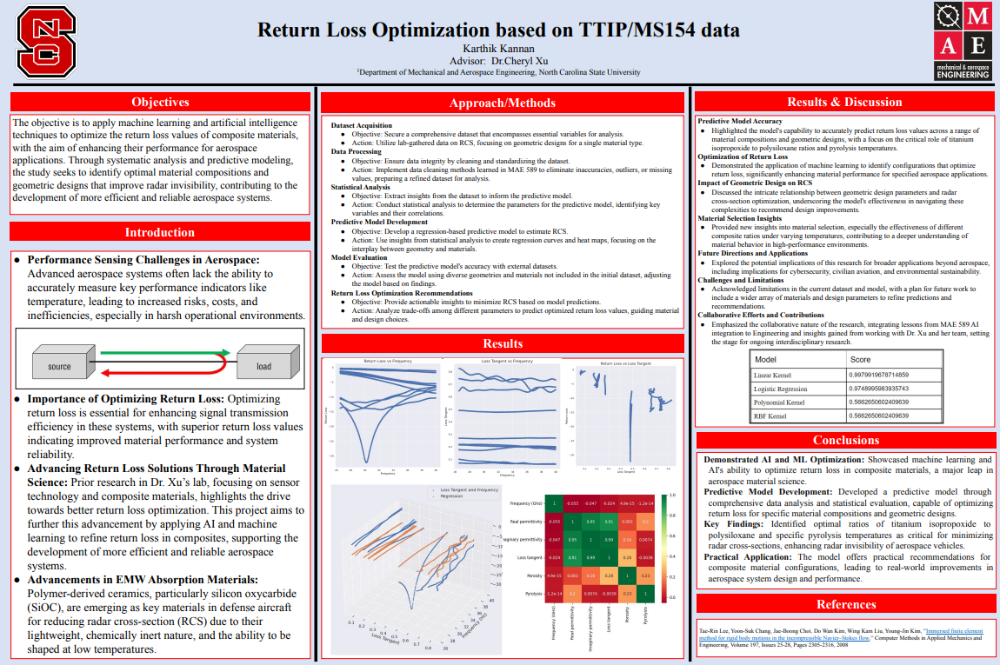

  

**Summary**
In **2022**, as an undergraduate researcher, I worked under **Dr. Cheryl Xu** at NC State University on AI-driven material discovery for **high-temperature ceramic matrix composites (CMCs)**. My project focused on using neural networks to predict composite return loss and explore candidate ceramic compositions for aerospace applications such as **hypersonic vehicles, thermal protection systems, and RF shielding**. This work earned me a **$4,000 grant** and a **First Place award** at the NC Space Grant Research Symposium.

---

### Research Objectives

- Develop a **neural network regression model** to predict material properties from experimental datasets.
- Explore candidate ceramic compositions and transfer the model to an industry collaborator with a larger dataset.
- Bridge **AI/ML techniques** with aerospace materials design workflows.
- Support long-term lab goals for **automated material discovery**.

---

### Key Contributions

- Built a **custom neural network using MATLAB and Python** to predict composite return-loss performance and explore candidate ceramic compositions.
- Preprocessed and normalized raw RF datasets, including noise filtering and dimensionality reduction.
- Collaborated with Synesquo/CDm to **manufacture composite panels**, which were later tested by NASA.
- Validated AI predictions through **ANSYS HFSS simulations**, benchmarking against lab-scale data.
- Authored technical documentation for reproducibility and future transfer learning applications.
- Presented results during **NC Space Grant Symposium** and faculty briefings.

---

### Dataset and model transfer

My initial work used data from **three to four actual composites**. I transferred the network to an industry collaborator, which trained it on a larger dataset to explore possible ceramic materials. Candidate compositions were model-generated hypotheses, rather than a claim that every proposed material had been manufactured and experimentally validated.

### Gallery

  

    
    
Presenting my poster during judging

  

  

    
    
First Place Award – NC Space Grant Symposium

  

  

    
    
Detailed research poster for NC Space Grant

  

---

### Reflection

This research gave me my first exposure to **bridging aerospace engineering with AI/ML**, a theme I’ve carried into my later projects like REACHR and GoAERO. It also solidified my interest in **multidisciplinary problem-solving**, combining data science, materials science, and aerospace applications.
