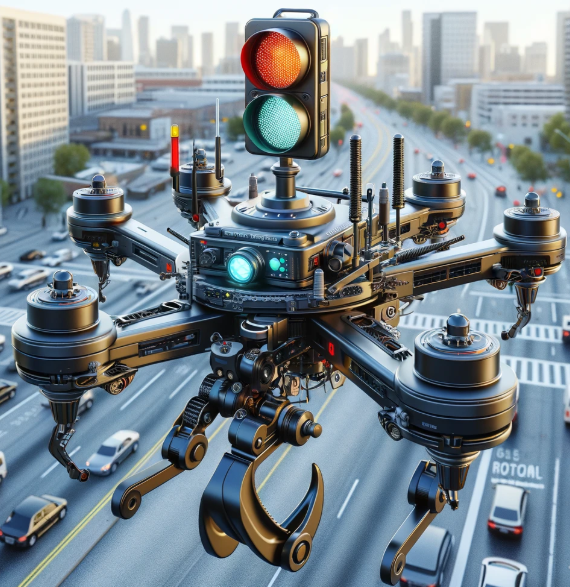
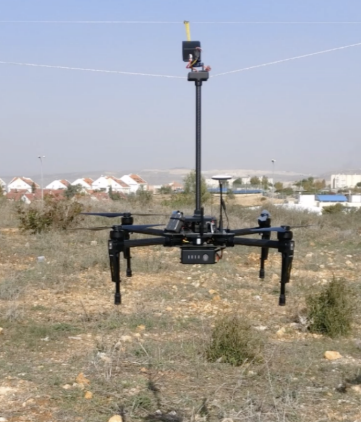
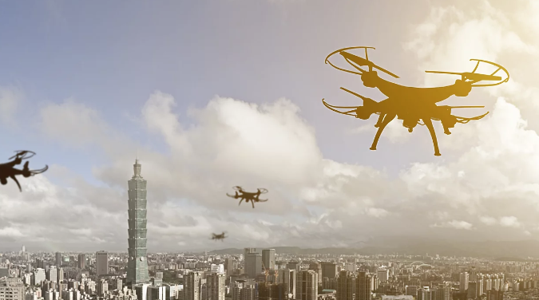
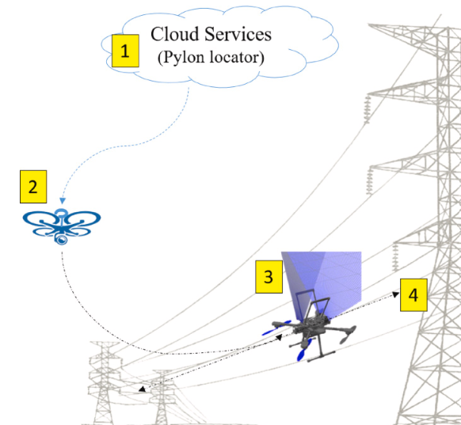
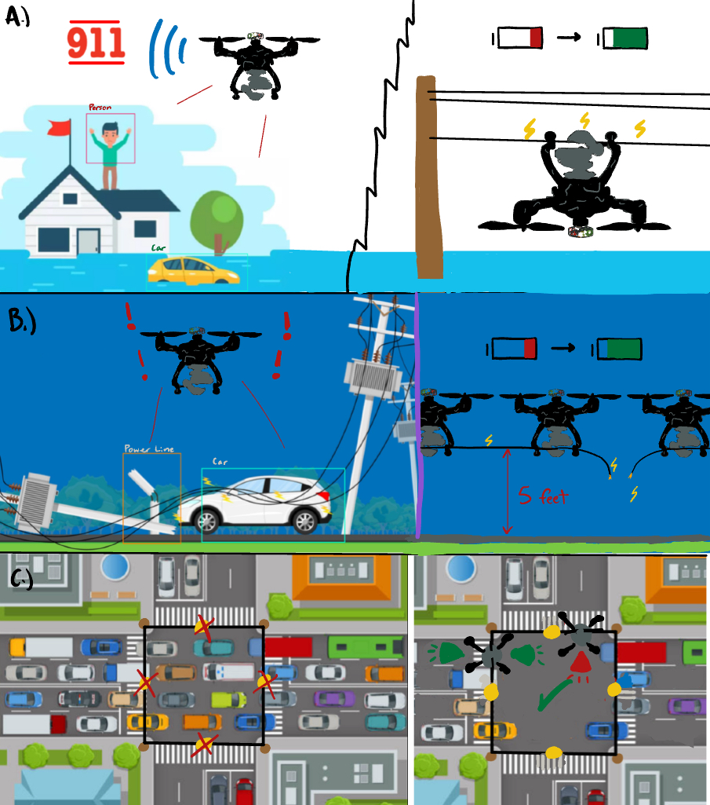
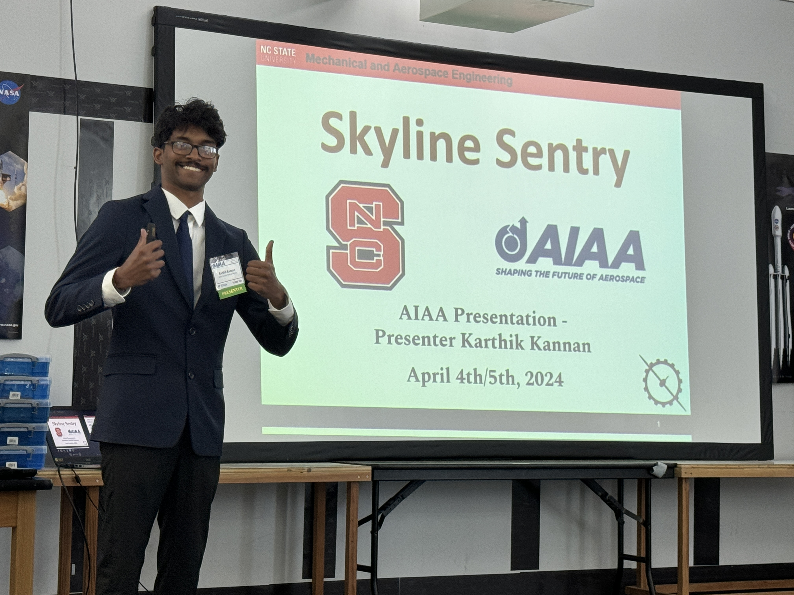

  

### The research question

This paper explores a UAV concept for disaster response and infrastructure monitoring, bringing together **computer vision, coordinated flight, and power-line charging**. The question was how those capabilities could support a mission that needs both useful situational information and more endurance than a single battery charge provides.

My contribution was to develop and communicate the proposed system: the concept of operations, the relationship between perception and mission planning, and the figures and technical explanation in the paper. It grew out of my aircraft design and autonomy work, including Poseidon.

### How the proposed pieces fit together

**Perception:** YOLOv8-based computer vision was part of the proposed approach to identifying people, infrastructure, and hazards in aerial imagery. A useful detection has to become information that supports a mission decision, which is why the perception work was presented alongside the operational concept.

**Mission coordination:** I explored swarm concepts and particle-swarm-based path planning as ways to divide coverage and coordinate tasks. These were proposed approaches within the paper, not a claim that a flight-tested swarm had completed the mission.

**Endurance:** The power-line charging concept addressed what an aircraft would do between battery-limited flight segments. Integrating that capability would require much more than recognizing a line: approach, positioning, the charging interface, and reliable departure would each need their own engineering and validation.

### What the publication represents

The result is a **published concept and technical presentation**, with the original figures and slides preserved below. The broader mission, charging, and hazard-handling capabilities remain proposals in this account. The Poseidon page separately documents the prototype's actual flight trials and remaining stability issues.

### Gallery

  

    
    
Power line charging mechanism for extended UAV operations

  

  

    
    
Drone swarm pack deployment

  

  

    
    
YOLOv8 detection of power lines

  

  

    
    
Proposed Concept of Operations

  

---

### My Role

I was the **lead author** of this paper, drawing from my senior design and research experiences.
My contributions included:

- Writing the full **AIAA paper** and preparing figures.
- Designing the **concept of operations** and proposed solution framework.
- Integrating **YOLOv8 computer vision** into UAV autonomy concepts.
- Exploring **swarm AI techniques** (PSOP pathfinding, DFC).
- Presenting at the **AIAA SciTech Forum 2024**.

---

### Turning a project into a technical argument

Writing the paper required me to explain how the proposed mission, perception tools, and charging concept related to one another. Figures and the concept of operations helped make those connections explicit for a reader who had not worked with our aircraft.

The publication draws on my design and research work, but its proposed autonomy and mission capabilities should be distinguished from the prototype flight results described on the Poseidon page. That separation is part of communicating the work accurately: the paper develops the concept, and the test record shows what the hardware demonstrated.

### Reflection

Publishing this paper was a defining experience in my undergraduate career. It taught me not only the **technical challenges** of bridging AI with aerospace, but also the **discipline of writing and communicating** at a professional level.

It strengthened my passion for **drones and autonomy**, gave me confidence in presenting ideas to a technical audience, and laid the foundation for later projects like **REACHR** and **GoAERO**.

This project showed me how UAVs can serve **both humanitarian disaster relief and urban smart city applications**, and how **ingenuity, persistence, and interdisciplinary collaboration** can create solutions that push aerospace forward.

---

### Presentation

  

    <iframe src="/assets/pdf/AIAA_Presentation.pdf"
            style="width:100%; height:500px; border-radius:12px; border:1px solid #ddd;"
            frameborder="0"></iframe>
    
Slides from my AIAA SciTech Presentation

    <a class="btn btn-primary mt-2" href="/assets/pdf/AIAA_Presentation.pdf" download>
      📥 Download Presentation
    </a>
  

  

    
    
Presenting my work at AIAA SciTech

  

---

### DOI Reference

**K. Kannan**, _“Innovative Drone Systems for Disaster Response,”_
AIAA SciTech Forum, 2024.
DOI: [10.2514/6.2024-85684](https://doi.org/10.2514/6.2024-85684)
